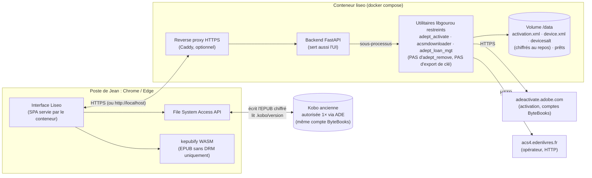

# Liseo : document d'architecture

> Statut : v0.2, 9 octobre 2026 (intègre les décisions de Jean)
> Auteur : Jean Collonvillé (GitHub `jcollonville`)
> Objet : transférer des livres numériques (prêts de bibliothèque `.acsm`, EPUB sans DRM ou tatoués) vers une liseuse Kobo depuis une interface web, sans installer Adobe Digital Editions (ADE) pour chaque livre.

Légende utilisée dans tout le document :
- ✅ **vérifié** : confirmé par une source citée (documentation officielle ou code source lu).
- ⚠️ **à vérifier** : vu dans une source non officielle (forum, blog) ou déduit, pas encore testé.
- ❓ **inconnu** : aucune source fiable trouvée. Il faut un test.

### Décisions actées (v0.2)

| # | Décision | Section |
|---|---|---|
| D1 | **Déploiement auto-hébergé** : image Docker installable en une commande (`docker compose up -d`). Les données de compte et d'activation sont persistées dans un volume, la configuration passe par des variables d'environnement. Le conteneur sert **aussi** l'interface web | §5, §8 |
| D2 | Moteur ADEPT entièrement dans le navigateur (WASM) **écarté**. Petit relais **envisagé puis écarté** au profit de l'auto-hébergement | §5.3 |
| D3 | Les Kobo de Jean sont des **modèles anciens qui n'ouvrent pas les `.acsm`**. Le chemin « `.acsm` natif » (firmware 6.0) sort du périmètre et reste une note pour plus tard | §6.2 |
| D4 | **Chemin principal** : chaque Kobo est autorisée **une seule fois** avec ADE et le compte de Jean. Le serveur Liseo active un appareil virtuel **sur le même compte** (libgourou : activation et récupération uniquement), puis l'EPUB **chiffré**, avec son `META-INF/rights.xml`, est copié sur la Kobo | §4, §5 |
| D5 | **Backend : Python (FastAPI) qui appelle les utilitaires libgourou en ligne de commande**, dans une image Docker construite en plusieurs étapes. Rust + FFI reste une option pour plus tard | §7 |
| D6 | **Premier jalon** : un prototype qui valide D4 sur une vraie Kobo ancienne | §10 |

---

## 1. Résumé

Liseo est un **serveur auto-hébergé** (conteneur Docker) qui sert une application web pour Chrome ou Edge. Cette application :

1. **détecte la Kobo** branchée en USB sur le poste de Jean, avec la File System Access API (`showDirectoryPicker`, puis lecture de `.kobo/version` et de `.adobe-digital-editions/`) ;
2. accepte par **glisser-déposer** :
   - un **`.acsm`** (prêt PNB, Adobe ADEPT) : le serveur l'échange contre l'**EPUB chiffré** grâce à son appareil virtuel lié au compte de Jean, et l'interface écrit ce fichier tel quel sur la Kobo ;
   - un **EPUB sans DRM ou tatoué** : copie directe, avec conversion KEPUB en option ;
3. ne retire **jamais** la protection : la Kobo, autorisée une fois avec ADE sur le même compte, ouvre elle-même le livre et applique la date de fin de prêt.

Ce chemin repose sur une propriété du protocole Adobe, documentée par libgourou : **la clé de chiffrement est commune à tous les appareils d'un même compte** (§6.1). ⚠️ Sa validation sur une Kobo ancienne est l'objet du premier jalon.

---

## 2. Contraintes légales (non négociables)

### 2.1 Interdiction de retirer ou contourner les DRM

En France, porter atteinte sciemment à une « mesure technique efficace » est puni d'une amende. **Fournir ou proposer des moyens** conçus pour le faire est puni plus lourdement : six mois d'emprisonnement et 30 000 € d'amende, selon l'art. L.335-3-1 du Code de la propriété intellectuelle, issu de la loi DADVSI ([Légifrance, art. L335-3-1](https://www.legifrance.gouv.fr/codes/article_lc/LEGIARTI000006279236)). Une image Docker publiée qui contiendrait un outil de retrait de DRM tomberait dans le second cas.

**Règles de conception de Liseo :**

1. **Aucun déchiffrement de contenu.** Liseo ne déchiffre jamais un EPUB ou un PDF protégé (Adobe ADEPT ou Readium LCP), même temporairement ou en mémoire.
2. **libgourou, seulement en partie.** Liseo n'utilise que l'activation (`adept_activate` : `signIn` + `activateDevice`), la récupération (`acsmdownloader` : `fulfill` + `download`) et le retour de prêt (`adept_loan_mgt -r`, `returnLoan`). L'**image Docker ne contient pas** l'utilitaire `adept_remove`. `acsmdownloader` y est **recompilé sans** l'option `--export-private-key`. Liseo n'utilise **jamais** la connexion anonyme (`--anonymous`), que libgourou présente lui-même comme réservée aux logiciels de retrait de DRM ([README libgourou](https://github.com/rledisez/libgourou/blob/master/README.md), [adept_activate.cpp](https://github.com/rledisez/libgourou/blob/master/utils/adept_activate.cpp)).
3. **Pas de conversion KEPUB d'un fichier protégé.** Convertir un livre chiffré suppose de le déchiffrer. Liseo refuse donc la conversion dès qu'il trouve `META-INF/encryption.xml` avec `META-INF/rights.xml` (Adobe) ou `META-INF/license.lcpl` (LCP). Calibre applique la même règle (« Not converting … to KEPUB as it is DRMed », [driver Kobo de calibre](https://github.com/kovidgoyal/calibre/blob/master/src/calibre/devices/kobo/driver.py)).
4. **La date de fin de prêt est gérée par la Kobo (RMSDK) et le serveur de l'opérateur.** Liseo ne modifie ni `rights.xml` ni la licence.
5. **Aucune exportation de clés.** Les fichiers d'activation (`activation.xml`, `device.xml`, `devicesalt`) restent dans le volume du conteneur. Aucune route d'API ne les renvoie.
6. **Tests automatisés de conformité** (CI) :
   - l'image ne contient ni `adept_remove` ni la chaîne `export-private-key` ;
   - toute sortie de `/api/fulfill` contient `META-INF/rights.xml` et `META-INF/encryption.xml` (sinon : erreur, rien n'est servi) ;
   - aucune route ne renvoie de contenu déchiffré.

### 2.2 Zones grises à faire valider

- ❓ **Statut juridique d'un client ADEPT tiers.** libgourou est une réimplémentation du protocole Adobe, faite sans l'accord d'Adobe ([README](https://github.com/rledisez/libgourou/blob/master/README.md), [brtkwr.com](https://brtkwr.com/posts/2026-08-18-sideloading-a-library-loan-onto-a-kobo-without-adobe-digital-editions/)). Utilisé sans retirer de DRM, il relève a priori de l'interopérabilité. **Je ne suis pas juriste** : avant toute publication publique de l'image, il faut un avis juridique.
- ❓ **Conditions d'utilisation de ByteBooks/Adobe et du PNB.** Un client non officiel peut enfreindre les CGU même s'il est légal. Le risque : blocage du compte ou de l'appareil. L'auto-hébergement à usage personnel limite l'exposition, sans la supprimer.

---

## 3. Contexte : analyse du fichier d'exemple

Le fichier `.acsm` fourni n'est qu'un **jeton de récupération**, pas le livre. Il a été lu localement, sans contacter le serveur et sans consommer le jeton.

| Champ | Valeur | Conséquence |
|---|---|---|
| `fulfillmentType` | `loan` | Prêt chronodégradable |
| `auth` | `user` | La récupération exige un compte Adobe/ByteBooks activé |
| `operatorURL` | `http://acs4.edenlivres.fr/fulfillment` | Serveur Eden Livres **en HTTP** : un navigateur ne peut pas l'appeler (§5.3). Le serveur Liseo, lui, le peut |
| `transaction` | `eden:Loan:…` | Prêt PNB distribué par Eden Livres |
| `expiration` | 2026-10-13 19:09 (heure de Paris) | Le jeton doit être utilisé avant cette date |
| `permissions/display/until` | 2026-11-06 19:09 (heure de Paris) | Fin du prêt, appliquée par la Kobo |
| `dc:title` / `dc:creator` | *Plus grand que le ciel*, Virginie Grimaldi (Flammarion) | Métadonnées affichables avant la récupération |
| `dc:format` | `application/epub+zip` | EPUB chiffré ADEPT |

La boîte de dialogue de la médiathèque propose ADE, Aldiko Next, Baobab, Brio Reader, Lea Reader, Lis-a, Ma Medi@thèque, Thorium Reader, Vivlio et « Autres ». Le mot de passe « test » est très probablement la **phrase secrète Readium LCP** de l'option LCP. ⚠️ Hypothèse non vérifiée, mais cohérente avec le fait que le PNB propose LCP ([EDRLab](https://www.edrlab.org/readium-lcp/certified-apps-servers/)). Ce mot de passe ne joue **aucun rôle** dans le flux Adobe.

> ⚠️ Toute récupération réelle **consomme** le jeton. Le prototype doit donc utiliser un `.acsm` que Jean accepte de « sacrifier » (§10, étape 0).

---

## 4. Flux utilisateur

### 4.1 Installation (une fois)

1. Sur une machine avec Docker (PC, NAS ou serveur personnel), Jean lance `docker compose up -d` (§8).
2. Il ouvre `https://liseo.<domaine-local>` (ou `http://localhost:8080` si le conteneur tourne sur le même PC) dans Chrome ou Edge. Il se connecte avec le mot de passe défini dans `LISEO_ADMIN_PASSWORD`.
3. **Assistant de compte** : Jean saisit son **identifiant ByteBooks**, qui remplace l'Adobe ID depuis le 23 juin 2026 (§6.1). Le serveur exécute `adept_activate` une seule fois et conserve l'activation dans le volume `/data`. Le mot de passe n'est pas conservé.

### 4.2 Préparation de chaque Kobo (une fois par Kobo)

1. **Autorisation unique avec ADE** sur un PC Windows ou Mac : `Aide → Autoriser l'ordinateur` avec le **même** identifiant ByteBooks, puis Kobo branchée → roue dentée → `Autoriser le périphérique` ([aide Kobo](https://help.kobo.com/hc/en-us/articles/360017814074-Add-eBooks-with-Adobe-Digital-Editions)). ✅ ADE peut ensuite être désinstallé.
2. Dans Liseo, **« Sélectionner ma liseuse »** (`showDirectoryPicker({mode:'readwrite'})`) puis choix du volume `KOBOeReader`.
3. Liseo lit `.kobo/version` (modèle, firmware) et vérifie la présence de `.adobe-digital-editions/activation.xml`. S'il manque, il affiche « Kobo non autorisée : faites l'étape ADE ». ⚠️ Liseo ne vérifie pas que le compte de la Kobo est le même que celui du serveur (§6.2) : un compte différent provoque « Content locked » ([ebooks.com](https://support.ebooks.com/hc/en-gb/articles/360000152956-Kobo-Content-locked-error)).
4. Le handle du dossier est mémorisé (IndexedDB, permission persistante, §6.3).

### 4.3 Glisser-déposer d'un `.acsm` (usage courant)

```
Dépôt du .acsm dans l'interface
  → analyse locale (titre, auteur, dates, opérateur) et affichage
  → POST /api/fulfill (le .acsm part vers le conteneur)
       → acsmdownloader : fulfill + download → EPUB CHIFFRÉ (+ META-INF/rights.xml)
       → contrôle : rights.xml et encryption.xml bien présents
  ← flux de l'EPUB chiffré vers le navigateur
  → écriture sur la Kobo : <racine>/Liseo/<Auteur> - <Titre>.epub
  → consigne « Éjectez la liseuse proprement », puis la Kobo indexe et ouvre le livre
```

### 4.4 Glisser-déposer d'un EPUB

1. Analyse du ZIP dans le navigateur (JSZip) : DRM Adobe, LCP, ou absence de DRM. Un EPUB tatoué apparaît comme « sans DRM », car le tatouage ne bloque pas la lecture et n'est pas détectable de façon fiable.
2. Si le livre est sans DRM et que l'option est cochée, conversion **KEPUB** (kepubify WASM, §6.6) puis écriture de `*.kepub.epub`.
3. Si le livre est protégé, copie telle quelle, sans conversion. Si c'est du LCP, Liseo avertit que la Kobo ne sait pas le lire (§6.5).

### 4.5 Gestion (phase ultérieure)

- Liste des prêts et de leurs échéances (métadonnées `.acsm` conservées dans `/data`).
- Retour anticipé d'un prêt (`adept_loan_mgt -r`).
- Suppression d'un livre de la Kobo (`removeEntry`), avec confirmation.

---

## 5. Architecture

### 5.1 Vue d'ensemble



Points clés :
- **Seul le conteneur parle aux serveurs ADEPT.** Le navigateur n'échange qu'avec le conteneur, sur la même origine : pas de CORS, pas de contenu mixte.
- **Le livre reste chiffré de bout en bout** : serveur de l'opérateur, puis conteneur, puis navigateur, puis Kobo. Seule la Kobo, autorisée avec le même compte, sait l'ouvrir.
- Si le conteneur tourne sur un NAS et la Kobo est branchée sur le PC, le fichier passe par le navigateur du PC. C'est voulu : la File System Access API est le seul moyen, sans installation, d'écrire sur la Kobo.

### 5.2 Composants

**Frontend** (servi en statique par FastAPI)
- TypeScript, Vite et Svelte (React possible).
- Modules :
  - `device/` : sélection du volume, détection Kobo, persistance du handle ;
  - `inspect/` : analyse `.acsm` (DOMParser) et EPUB (JSZip) ;
  - `transfer/` : écriture en flux avec `createWritable()` et vérification de la taille après écriture ;
  - `kepub/` : kepubify WASM ;
  - `api/` : appels au backend.
- Lecture **seule** de `.kobo/KoboReader.sqlite` (sql.js, copie en mémoire) pour afficher la bibliothèque. Liseo n'écrit **jamais** dans `.kobo/`.

**Backend** (Python 3.12, FastAPI, uvicorn)

| Route | Rôle | Remarques |
|---|---|---|
| `POST /api/login` | Session d'administration (mot de passe `LISEO_ADMIN_PASSWORD`) | Cookie `HttpOnly`, `Secure`, `SameSite=Strict` |
| `GET /api/status` | Version, état de l'activation | |
| `POST /api/account/activate` | `{login, password}` → `adept_activate` | Mot de passe transmis via un **pseudo-terminal** (l'outil le demande de façon interactive s'il n'est pas passé avec `-p`, [adept_activate.cpp](https://github.com/rledisez/libgourou/blob/master/utils/adept_activate.cpp)), donc jamais dans `argv` ni dans les journaux |
| `DELETE /api/account` | Supprime l'activation locale | ❓ ne libère pas forcément l'emplacement d'appareil côté Adobe |
| `POST /api/fulfill` | `.acsm` → `acsmdownloader -D /data/adept -o <tmp>` → **EPUB chiffré** en flux | Garde-fou rights/encryption. Fichier temporaire supprimé ensuite. Un seul traitement à la fois par compte |
| `POST /api/loans/{id}/return` | `adept_loan_mgt -r` | Phase 2 |

- Chaque sous-processus a un délai maximal et un répertoire temporaire isolé. Les codes de sortie et les messages `Exception code : 0x…` de libgourou sont traduits en erreurs lisibles (par exemple `E_ADEPT_RESET_PW_REQUIRED` → « utilisez un identifiant ByteBooks »).
- Liste fermée des hôtes que les utilitaires peuvent joindre (`adeactivate.adobe.com` et `operatorURL` connues, par exemple `acs4.edenlivres.fr`). Elle se configure avec `LISEO_ALLOWED_OPERATORS`, et un `.acsm` dont l'opérateur est inconnu est refusé.

**Stockage des identifiants et des clés** (volume `/data`)

| Donnée | Sensibilité | Stockage |
|---|---|---|
| Mot de passe ByteBooks | Critique | **Jamais stocké.** Gardé en mémoire le temps d'`adept_activate` |
| `activation.xml` (contient `privateLicenseKey`) + `devicesalt` | **Critique** : ensemble, ils permettent de lire tous les livres du compte | `/data/adept/`, droits `0600`, utilisateur non root. Chiffrés au repos avec `LISEO_SECRET_KEY` (déchiffrés dans un `tmpfs` le temps d'un appel CLI) |
| `device.xml` | Moyenne | Idem |
| Métadonnées des prêts | Faible | `/data/liseo.db` (SQLite) |
| `.acsm` reçus et EPUB chiffrés | Faible à moyenne | Temporaires (`tmpfs`), supprimés après envoi |

### 5.3 Alternatives écartées

**Moteur ADEPT dans le navigateur (WASM), sans serveur : rejeté.**
- **Contenu mixte** : l'opérateur Eden est en `http://`. Depuis une page HTTPS, un `fetch()` vers une URL `http://` est bloqué ([MDN, contenu mixte](https://developer.mozilla.org/en-US/docs/Web/Security/Mixed_content)). ✅ Or la File System Access API exige un contexte sécurisé, donc HTTPS ([MDN](https://developer.mozilla.org/en-US/docs/Web/API/Window/showDirectoryPicker)). ✅ Les deux exigences sont incompatibles.
- **CORS** : les requêtes ADEPT (`POST`, `Content-Type: application/vnd.adobe.adept+xml`) ne sont pas des requêtes CORS « simples » et déclenchent une requête préalable. ❓ Rien n'indique que les serveurs Adobe/ByteBooks ou Eden renvoient les en-têtes CORS nécessaires. Je ne l'ai pas testé, pour ne pas solliciter ces serveurs.
- S'y ajoute le coût du portage de libgourou en WASM : il faudrait réimplémenter `DRMProcessorClient` (HTTP, RSA, AES, ZIP) en WebCrypto.

**Petit relais public (« relais aveugle ») : envisagé puis écarté.** Le moteur aurait tourné en WASM et un relais minimal aurait transmis les requêtes ADEPT. Le mot de passe y reste protégé, puisqu'il est chiffré en RSA avec le certificat d'Adobe par libgourou ([libgourou.cpp](https://github.com/rledisez/libgourou/blob/master/src/libgourou.cpp)). En revanche :
- le relais voit les jetons `.acsm` et les identifiants de compte ;
- il crée un service public avec son exposition juridique ;
- il ne supprime pas le travail de portage WASM.

**Jean préfère l'auto-hébergement** : les données restent chez lui et la maintenance est plus simple.

**Assistant local natif (binaire) : non retenu pour l'instant.** La même pile Docker tourne sur un PC (`localhost`), ce qui couvre ce besoin.

---

## 6. Points techniques vérifiés et inconnues

### 6.1 Protocole Adobe ADEPT et libgourou

- **libgourou** est une implémentation libre du protocole ADEPT : création et activation d'un appareil, récupération d'un `.acsm`, retour de prêt, et aussi retrait de DRM, une fonction que Liseo exclut. ✅ ([README](https://github.com/rledisez/libgourou/blob/master/README.md))
- **Licences** : la bibliothèque est sous **LGPL v3 ou ultérieure**, les utilitaires sous **BSD**. ✅ Version 0.8.10, lue sur le miroir [rledisez/libgourou](https://github.com/rledisez/libgourou) (2 septembre 2026). Le dépôt officiel, [forge.soutade.fr](https://forge.soutade.fr/soutade/libgourou), est protégé par un anti-robot.
- **Dépendances** : pugixml, libcurl, OpenSSL et libzip. uPDFParser est compilé en interne. ✅
- **Comportement vérifié dans le code** :
  - `download()` insère `META-INF/rights.xml` dans l'EPUB **sans le déchiffrer**. ✅
  - Le `signIn` chiffre `deviceKey + identifiant + mot de passe` en RSA avec le certificat d'authentification d'Adobe avant l'envoi à `…/SignInDirect`. ✅
  - Le serveur d'activation par défaut est `https://adeactivate.adobe.com/adept`, et libgourou se présente comme RMSDK `10.0.4`. ✅
  - Récupération : `operatorURL + "/Fulfill"`, précédée si besoin de `operatorAuth` et `InitLicenseService`. ✅
- **Clé partagée par compte, fondement du chemin principal** : selon le README, « ePub are encrypted using a shared key: one account / multiple devices, so you can create and register a device into your computer and read downloaded (and encrypted) ePub file with your eReader configured using the same AdobeID account ». ✅ C'est une affirmation de la documentation, ⚠️ **pas encore testée sur une Kobo** : c'est le jalon 1.
- **Limite d'appareils** : chaque compte a un nombre limité d'appareils activés, « 5 ou 6 en théorie, plus de 20 en pratique » ([ACSMDownloader](https://forge.soutade.fr/soutade/ACSMDownloader)). ⚠️ Liseo active **un seul** appareil virtuel et le conserve dans `/data`. Il ne faut pas supprimer ce volume à la légère.
- **Passage d'Adobe ID à ByteBooks (Wipro)** : depuis le **23 juin 2026**, les nouvelles autorisations exigent un identifiant ByteBooks. Les appareils déjà autorisés continuent de fonctionner ([OverDrive](https://help.overdrive.com/en-us/2336.htm), [Kobo](https://help.kobo.com/hc/en-us/articles/360017814074-Add-eBooks-with-Adobe-Digital-Editions), [ByteBooks](https://dtsbytebooks.com/transition-help)). ✅ Avec libgourou, un identifiant Adobe renvoie `E_ADEPT_RESET_PW_REQUIRED`. Un identifiant ByteBooks fonctionne, mais ce n'est qu'un ⚠️ témoignage d'utilisateur ([issue #30](https://forge.soutade.fr/soutade/libgourou/issues/30)). ⚠️ Inconnu : une Kobo autorisée **avant** le 23 juin avec l'ancien Adobe ID partage-t-elle la même clé de compte que l'appareil virtuel activé avec le ByteBooks ID « migré » (même adresse e-mail) ? Les sources recommandent la même adresse « pour garder l'accès aux livres existants » ([OverDrive](https://help.overdrive.com/en-us/2336.htm)), ce qui le suggère sans le garantir. En cas de doute, réautoriser la Kobo avec ADE et ByteBooks.

### 6.2 Autorisation Adobe d'une Kobo

- **Méthode officielle, retenue** : ADE sur un ordinateur, puis « Authorize Device » sur la Kobo branchée, avec le **même** compte ([aide Kobo](https://help.kobo.com/hc/en-us/articles/360017814074-Add-eBooks-with-Adobe-Digital-Editions), [aide Kobo, bibliothèques](https://help.kobo.com/hc/en-us/articles/360019374554-Borrow-eBooks-from-the-public-library-using-your-library-s-website)). ✅ Si les comptes diffèrent : « Content locked » ([ebooks.com](https://support.ebooks.com/hc/en-gb/articles/360000152956-Kobo-Content-locked-error)). ✅ La documentation de Kobo, mise à jour pour ByteBooks, prouve que les Kobo actuelles lisent toujours les EPUB Adobe.
- **Emplacement** : `.adobe-digital-editions/` à la racine du stockage USB. `activation.xml` y est créé par l'autorisation ADE ([MobileRead](https://www.mobileread.com/forums/showthread.php?p=4459227), [MobileRead](https://www.mobileread.com/forums/showthread.php?p=4214809)). ⚠️ Ce sont des sources de forum, concordantes.
- **Clé propre de la Kobo (`devicesalt`)** : souvent accessible seulement avec un accès root ([ACSMDownloader](https://forge.soutade.fr/soutade/ACSMDownloader)). ⚠️ Liseo n'en a pas besoin dans le chemin principal.
- **Autoriser une Kobo sans ADE : hors périmètre.** ❓ Aucune méthode fiable. Un essai d'août 2026 a copié les fichiers d'un appareil virtuel dans `.adobe-digital-editions/` d'une Kobo jamais autorisée (firmware 4.45) : le livre a été ignoré sans erreur ([brtkwr.com](https://brtkwr.com/posts/2026-08-18-sideloading-a-library-loan-onto-a-kobo-without-adobe-digital-editions/)). L'auteur en conclut que Kobo a retiré ADEPT vers le firmware 4.32. Cette conclusion est **contredite** par l'aide officielle de Kobo et par MobileRead (« RMSDK is alive and well for Adobe DRM-protected ePubs », [MobileRead](https://www.mobileread.com/forums/showthread.php?p=4611443)). ⚠️ C'est néanmoins un **signal de risque pour le jalon 1**, à lever par le test (§9, R1).
- **Note pour plus tard : `.acsm` natif sur la liseuse.** ⚠️ Selon MobileRead (septembre 2026), le firmware Kobo **6.0.274403** (Clara BW, Clara Colour, Libra Colour, Elipsa 2E) accepterait la connexion Adobe sur l'appareil et l'ajout direct d'un `.acsm`. tolino 5.18 fait de même ([MobileRead](https://www.mobileread.com/forums/showthread.php?p=4611443), [e-reader-forum.de](https://www.e-reader-forum.de/t/firmware-5-18-264769.162375/)). **Hors périmètre** : les Kobo de Jean n'ont pas cette fonction. Si Jean change de liseuse, Liseo pourra détecter ce firmware et proposer de copier simplement le `.acsm`.

### 6.3 Détection de la Kobo depuis le navigateur

- **File System Access API** : `showDirectoryPicker({mode:'readwrite'})` exige un **contexte sécurisé** (HTTPS ou localhost) et une **action de l'utilisateur**. Un dossier jugé sensible peut être refusé (`AbortError`) ([MDN](https://developer.mozilla.org/en-US/docs/Web/API/Window/showDirectoryPicker)). ✅ Elle est disponible dans les navigateurs Chromium sur ordinateur, pas dans Firefox ni Safari ([Chrome for Developers](https://developer.chrome.com/docs/capabilities/web-apis/file-system-access)). ✅
- **Racine du volume** : d'après le code de Chromium, un dossier est bloqué s'il figure dans la liste de blocage ou s'il en est le **parent**. La racine d'un volume amovible (`E:\`, `/Volumes/KOBOeReader`) ne devrait donc pas l'être ([code Chromium](https://chromium.googlesource.com/chromium/src/+/refs/heads/main/chrome/browser/file_system_access/chrome_file_system_access_permission_context.cc)). ⚠️ À confirmer sur Windows, macOS et Linux, avec l'accès aux dossiers cachés `.kobo` et `.adobe-digital-editions`.
- **Persistance** : le handle est stocké dans IndexedDB. L'option « Autoriser à chaque visite » existe depuis Chrome 122 ([Chrome blog](https://developer.chrome.com/blog/persistent-permissions-for-the-file-system-access-api)). ✅ Il n'y a **aucun événement de branchement** : Liseo revérifie l'accès au chargement et à chaque action.
- **Identification** : `.kobo/version` est une ligne CSV. Champ 1 : numéro de série. Champ 3 : firmware. Dernier champ : identifiant de modèle, dont les 3 derniers chiffres donnent le code de l'appareil ([driver calibre](https://github.com/kovidgoyal/calibre/blob/master/src/calibre/devices/kobo/driver.py), [MobileRead](https://www.mobileread.com/forums/showthread.php?page=2&t=360501)). ✅ La base `KoboReader.sqlite` se trouve dans `.kobo/` ([MobileRead Wiki](https://wiki.mobileread.com/wiki/Kobo_Firmware)). ✅
- **WebUSB n'est pas une option** : le stockage de masse (classe `0x08`) est une **classe protégée**, et `claimInterface()` est refusé hors Isolated Web Apps ([spécification WebUSB](https://wicg.github.io/webusb/)). ✅
- **Éjection** : le navigateur ne peut pas éjecter un volume. Liseo affiche une consigne claire. ⚠️ Risque de fichier tronqué si l'utilisateur débranche trop tôt.

### 6.4 HTTPS et accès à l'interface

- La File System Access API impose un contexte sécurisé. `http://localhost` en est un, mais **`http://nas.local:8080` n'en est pas un** ([MDN](https://developer.mozilla.org/en-US/docs/Web/Security/Mixed_content), [MDN `showDirectoryPicker`](https://developer.mozilla.org/en-US/docs/Web/API/Window/showDirectoryPicker)). ✅ Conséquence pour le déploiement :
  - **conteneur sur le même PC que la Kobo** : `http://localhost:8080` suffit ;
  - **conteneur sur un NAS ou un serveur** : HTTPS obligatoire, via un reverse proxy. Caddy fournit des certificats automatiques, publics ou internes ([Caddy, HTTPS automatique](https://caddyserver.com/docs/automatic-https)). Traefik, Nginx Proxy Manager et le proxy intégré du NAS conviennent aussi. Avec un certificat interne, l'autorité de Caddy doit être approuvée sur le PC.
- Le conteneur appelle l'opérateur Eden en HTTP. Ce n'est pas un problème côté serveur, mais ces échanges, signés et non chiffrés, circulent en clair sur Internet, quel que soit le client. Le livre lui-même reste chiffré.

### 6.5 Kobo et Readium LCP

- **État au 9 octobre 2026** : les liseuses Kobo **ne figurent pas** dans la liste des systèmes LCP d'EDRLab. Seuls les tolino sont compatibles LCP depuis 2019 ([EDRLab](https://www.edrlab.org/readium-lcp/certified-apps-servers/)). ✅ Une prise en charge est annoncée pour 2026 ([r/kobo](https://www.reddit.com/r/kobo/comments/1qbv84w/readium_lcp_drm_support_for_kobo_ereaders_is/)), mais aucune note de version ne la confirme ([MobileRead](https://www.mobileread.com/forums/showthread.php?t=375417)). ⚠️ Les Kobo anciennes ont encore moins de chances d'en bénéficier.
- **Liseuses compatibles LCP en France** : Vivlio, PocketBook, inkBOOK, Bookeen ([EDRLab](https://www.edrlab.org/readium-lcp/certified-apps-servers/)). ✅
- **Risque stratégique** : le PNB prévoit de **supprimer la distribution Adobe d'ici 2026** ([EDRLab](https://www.edrlab.org/readium-lcp/certified-apps-servers/)). ⚠️ Adobe est encore proposé en octobre 2026 (cf. le `.acsm` d'exemple).

### 6.6 Conversion KEPUB

- **kepubify** : licence **MIT**, écrit en Go, utilisable en ligne de commande, comme bibliothèque et en **version web JS/WASM**. ✅ Dernière version : v4.0.4, mars 2022 ([dépôt](https://github.com/pgaskin/kepubify), [version web](https://pgaskin.net/kepubify/try/)).
- Le fichier produit se nomme `*.kepub.epub` (convention du driver calibre). ✅ La conversion est réservée aux EPUB sans DRM (règle 2.1.3). Le binaire est intégré à une version figée.

---

## 7. Choix technologiques

### 7.1 Langage du backend : Python + CLI libgourou (retenu) ou Rust + FFI

| Critère | **Python (FastAPI) + utilitaires libgourou en CLI** | Rust (axum) + libgourou en FFI |
|---|---|---|
| Construction de l'image Docker | ✅ Simple : étape 1 `make` de libgourou (Debian, paquets `-dev`), étape 2 `python:3.12-slim` avec les bibliothèques d'exécution | Plus lourd : chaîne C++ et Rust, wrapper C ou `cxx`, liaison avec `libgourou.so` |
| Code à écrire autour de libgourou | ✅ Aucun en C++ : l'implémentation de référence de `DRMProcessorClient` (cURL, OpenSSL, libzip) est déjà dans `utils/` | Exposer `DRMProcessorClient` et sa gestion d'erreurs à travers le FFI |
| Isolation | ✅ Un plantage C++ n'arrête pas le serveur (sous-processus) | Un plantage C++ peut arrêter le serveur |
| Contrôle des fonctions interdites | ✅ On n'embarque pas `adept_remove` et on recompile `acsmdownloader` sans `--export-private-key` | ✅ Wrapper limité à 5 fonctions |
| Inconvénients | Analyse des messages et codes de sortie. Mot de passe à passer par un pseudo-terminal | Temps de développement plus long |
| Intérêt hors Docker | Moindre (distribution d'un binaire) | ✅ Binaire unique |

**Choix pour l'image Docker : Python 3.12 + FastAPI + utilitaires libgourou appelés en sous-processus.**

Docker supprime le principal avantage de Rust (le binaire unique sans dépendances), alors que la version CLI réutilise le code de référence de libgourou sans écrire de C++. On isole les plantages, et le prototype du jalon 1 devient directement le cœur du produit. On reconsidérera Rust + FFI si l'on vise un jour un binaire natif, ou si l'analyse des sorties CLI devient trop fragile.

### 7.2 libgourou : CLI, FFI ou réimplémentation

| Option | Verdict |
|---|---|
| **CLI** (`adept_activate`, `acsmdownloader`, `adept_loan_mgt`) | **Retenu** |
| FFI (lien avec `libgourou.so`) | Possible plus tard, avec Rust ou `pybind11` |
| Réimplémentation (par exemple en s'inspirant de [DeACSM](https://github.com/Leseratte10/acsm-calibre-plugin), Python, GPL-3.0) | Non : coût, bugs, risque de licence GPL |

Build : libgourou figé à un **commit vérifié**, avec un patch appliqué au build. Le patch :
- retire `adept_remove` de la cible `utils` ;
- supprime l'option `--export-private-key` d'`acsmdownloader.cpp`.

Pour la LGPL v3, avec les utilitaires (BSD) liés dynamiquement à `libgourou.so`, il suffit de joindre la licence et les sources, patch compris, avec l'image. La licence de Liseo reste à décider (GPL-3.0 ou LGPL-3.0 suggérées).

### 7.3 Frontend

TypeScript, Vite et Svelte. JSZip, sql.js (lecture seule), kepubify WASM et idb-keyval. Tests : Playwright, avec un répertoire simulé (OPFS).

---

## 8. Déploiement Docker

### 8.1 Image

Image multi-étapes publiée sur `ghcr.io/jcollonville/liseo` (amd64 et arm64 pour les NAS) :

```dockerfile
# Étape 1 : libgourou (commit figé + patch « sans retrait de DRM »)
FROM debian:bookworm-slim AS gourou
RUN apt-get update && apt-get install -y --no-install-recommends \
      build-essential git ca-certificates libpugixml-dev libcurl4-openssl-dev libssl-dev libzip-dev
COPY third_party/libgourou /src/libgourou
COPY patches/libgourou-no-drm-removal.patch /src/
RUN cd /src/libgourou && git apply ../libgourou-no-drm-removal.patch && make BUILD_UTILS=1 \
 && test ! -e utils/adept_remove   # garde-fou

# Étape 2 : frontend
FROM node:22-slim AS web
COPY web /web
RUN cd /web && npm ci && npm run build

# Étape 3 : exécution
FROM python:3.12-slim
RUN apt-get update && apt-get install -y --no-install-recommends \
      libpugixml1v5 libcurl4 libssl3 libzip4 && useradd -u 1000 liseo
COPY --from=gourou /src/libgourou/libgourou.so* /usr/local/lib/
COPY --from=gourou /src/libgourou/utils/adept_activate /src/libgourou/utils/acsmdownloader \
                   /src/libgourou/utils/adept_loan_mgt /usr/local/bin/
COPY --from=web /web/dist /app/static
COPY backend /app
RUN ldconfig && pip install --no-cache-dir -r /app/requirements.txt
USER liseo
VOLUME /data
EXPOSE 8080
CMD ["uvicorn", "liseo.main:app", "--host", "0.0.0.0", "--port", "8080"]
```

⚠️ Esquisse : les noms exacts des paquets et des fichiers produits par le `Makefile` (sous-modules, `make update_lib`) restent à valider au jalon 1. [docker-libgourou](https://github.com/bcliang/docker-libgourou) (GPL-3.0) peut servir de référence de build, **sans** reprendre ses scripts de retrait de DRM.

### 8.2 `docker-compose.yml` (installation en une commande)

```yaml
services:
  liseo:
    image: ghcr.io/jcollonville/liseo:latest
    restart: unless-stopped
    ports:
      - "127.0.0.1:8080:8080"     # localhost uniquement par défaut
    volumes:
      - liseo-data:/data          # activation Adobe/ByteBooks + base des prêts (à sauvegarder)
    tmpfs:
      - /tmp                      # .acsm et EPUB chiffrés temporaires, jamais sur disque
    environment:
      LISEO_ADMIN_PASSWORD: ${LISEO_ADMIN_PASSWORD:?à définir dans .env}
      LISEO_SECRET_KEY: ${LISEO_SECRET_KEY:?à définir dans .env}   # chiffrement au repos de /data/adept
      LISEO_ALLOWED_OPERATORS: "acs4.edenlivres.fr"
      LISEO_PUBLIC_URL: "http://localhost:8080"
      TZ: Europe/Paris
    read_only: true
    security_opt: ["no-new-privileges:true"]
volumes:
  liseo-data:
```

Installation : `curl -O …/docker-compose.yml && cp .env.example .env` (définir les deux secrets), puis `docker compose up -d`.

### 8.3 Variantes d'accès (HTTPS)

| Cas | Configuration |
|---|---|
| Conteneur sur le PC où la Kobo est branchée | `http://localhost:8080` : contexte sécurisé, rien de plus à faire |
| Conteneur sur un NAS ou un serveur du réseau local | Profil compose `https` qui ajoute **Caddy** (certificat interne `tls internal` à approuver sur le PC, ou certificat public via un nom de domaine et un challenge DNS). Port 8080 non publié, seul Caddy est exposé |
| Accès depuis Internet | **Déconseillé.** Si besoin : VPN (WireGuard, Tailscale) plutôt qu'une exposition publique |

### 8.4 Sauvegarde

Le volume `liseo-data` contient l'activation de l'appareil virtuel. Le perdre oblige à en activer un nouveau, qui consomme un emplacement sur le compte (§6.1). Liseo propose donc une sauvegarde **chiffrée**, exportable uniquement vers un autre conteneur Liseo, jamais en clair (règle 2.1.5).

---

## 9. Sécurité et confidentialité

1. **Zéro déchiffrement** (§2.1) : binaires interdits absents de l'image, garde-fous sur `/api/fulfill`, tests CI, relecture des PR.
2. **Mot de passe ByteBooks** : jamais stocké, jamais dans `argv` (pseudo-terminal), jamais dans les journaux.
3. **Clés d'activation** : chiffrées au repos dans `/data` (`LISEO_SECRET_KEY`), déchiffrées en `tmpfs` le temps d'un appel, droits `0600`, utilisateur non root, système de fichiers en lecture seule.
4. **Accès à l'interface et à l'API** :
   - mot de passe administrateur et session sécurisée ;
   - protection CSRF (`SameSite=Strict` et vérification de l'en-tête `Origin`) ;
   - écoute sur `127.0.0.1` par défaut.
5. **Sorties réseau limitées** à une liste fermée (Adobe/ByteBooks et opérateurs connus), avec délais maximaux et tailles limitées.
6. **Écriture sur la Kobo** : uniquement dans `Liseo/` (ou à la racine), **jamais** dans `.kobo/` ni dans `.adobe-digital-editions/`.
7. **Données personnelles** : aucune télémétrie. Seuls Adobe/ByteBooks et l'opérateur sont contactés, comme avec ADE.
8. **Chaîne d'approvisionnement** : libgourou figé à un commit vérifié, image construite en CI, SBOM, et signature de l'image (cosign) si possible.

---

## 10. Plan par étapes

### Étape 0 : ce que Jean doit fournir ou faire (avant le jalon 1)

| # | Action de Jean | Pourquoi |
|---|---|---|
| 1 | Pour **chaque Kobo** : modèle et version du firmware (`Paramètres → Informations sur l'appareil`, ou contenu du fichier `.kobo/version` à la racine de la Kobo branchée) | Savoir quel RMSDK et quel firmware on teste, et repérer d'éventuelles différences entre modèles |
| 2 | Vérifier si `.adobe-digital-editions/activation.xml` existe déjà sur chaque Kobo (fichiers cachés visibles), et avec **quel compte** elle a été autorisée, si Jean s'en souvient | Une Kobo déjà autorisée avec l'ancien Adobe ID pose la question de la compatibilité avec le compte ByteBooks (§6.1) |
| 3 | Créer ou migrer un **identifiant ByteBooks** avec la **même adresse e-mail** que l'ancien Adobe ID, s'il en a un ([ByteBooks](https://dtsbytebooks.com/transition-help)) | Les nouvelles activations exigent ByteBooks depuis le 23/06/2026 |
| 4 | **Autoriser une fois chaque Kobo avec ADE** (Windows ou Mac) avec ce même identifiant ByteBooks : autoriser l'ordinateur, puis le périphérique ([aide Kobo](https://help.kobo.com/hc/en-us/articles/360017814074-Add-eBooks-with-Adobe-Digital-Editions)). Si la Kobo était autorisée avec un autre compte : « Effacer l'autorisation » puis réautoriser | Prérequis du chemin principal |
| 5 | Fournir un **`.acsm` neuf**, jamais ouvert ailleurs, pour un prêt que Jean accepte de consommer (le test utilise le jeton). L'exemple actuel expire le 13/10 à 19h09 | Une récupération consomme le prêt |
| 6 | Une machine avec **Docker** (le PC suffit pour le jalon 1) et Chrome ou Edge | Exécution du prototype |
| 7 | Accord explicite pour que le prototype contacte `adeactivate.adobe.com` et l'opérateur Eden avec son compte | Actions réelles sur son compte et son prêt |

### Jalon 1 : prototype de validation du chemin principal (2 à 3 jours)

- Image Docker minimale :
  - libgourou patché (sans `adept_remove` ni export de clé) ;
  - un script `liseo-proto` qui fait `adept_activate` (ByteBooks, saisie interactive), puis `acsmdownloader`, puis vérifie `rights.xml` et `encryption.xml`.
- Copie manuelle de l'EPUB chiffré sur la Kobo (explorateur de fichiers), éjection, ouverture du livre.
- **Critères de réussite** :
  1. le livre s'ouvre sur la Kobo ancienne ;
  2. la date de fin de prêt est affichée et respectée ;
  3. aucun « Content locked » ;
  4. l'activation est réutilisée pour un 2e `.acsm` sans nouvelle activation.
- **Résultat** : un tableau « modèle / firmware / compte / résultat », plus le journal. En cas d'échec, diagnostiquer avant d'aller plus loin : compte, migration Adobe ID vers ByteBooks, ou firmware (cf. brtkwr, §6.2).

### Jalon 2 : interface web + API (4 à 6 jours)

- FastAPI : `/api/account/activate` (pseudo-terminal), `/api/fulfill`, session d'administration.
- Interface : sélection et détection de la Kobo, dépôt d'un `.acsm`, écriture directe sur la Kobo, EPUB sans DRM avec KEPUB WASM.
- `docker-compose.yml` en une commande, `.env.example`, documentation `localhost` et Caddy.

### Jalon 3 : robustesse et sécurité

- Chiffrement au repos de `/data`, garde-fous CI (binaires interdits, rights/encryption), liste fermée d'opérateurs, image multi-architecture signée, sauvegarde chiffrée.

### Jalon 4 : gestion des prêts

- Liste et échéances, retour anticipé (`adept_loan_mgt -r`), plusieurs Kobo mémorisées.

### Plus tard (hors périmètre actuel)

- `.acsm` natif pour les Kobo en firmware 6.x et les tolino 5.18 (§6.2).
- LCP pour Vivlio et PocketBook, et suivi de LCP sur Kobo (§6.5).
- Rust + FFI si un binaire natif devient utile (§7.1).

---

## 11. Risques et inconnues

| # | Risque ou inconnue | Gravité | Probabilité | Réponse |
|---|---|---|---|---|
| R1 | **Chemin principal non validé** : une Kobo ancienne autorisée par ADE ouvre-t-elle un EPUB récupéré par l'appareil virtuel du même compte ? (README de libgourou : oui ; essai brtkwr sur une Kobo non autorisée : échec) | **Critique** | Moyenne | Jalon 1 avant tout développement |
| R2 | **Kobo autorisée avec l'ancien Adobe ID** et appareil virtuel activé avec ByteBooks : même clé de compte ? | Haute | Moyenne | Test. Sinon, réautorisation ADE avec ByteBooks |
| R3 | **Fin d'Adobe au PNB** (annoncée pour 2026) | Haute | Moyenne | Surveiller. LCP n'aide pas sur Kobo, il faudrait une autre liseuse |
| R4 | **Kobo sans LCP** | Moyenne | Haute | Hors périmètre |
| R5 | **Changements ByteBooks/Wipro** : URL, protocole, blocage des clients tiers (libgourou se présente comme RMSDK 10.0.4) | Haute | Moyenne | Suivre libgourou, isoler les appels CLI |
| R6 | **Limite d'appareils par compte**, perte du volume `/data` | Moyenne | Moyenne | Une seule activation, sauvegarde chiffrée |
| R7 | **Statut juridique et CGU** d'un client ADEPT tiers, publication de l'image | Haute | Faible à moyenne | Usage personnel auto-hébergé. Avis juridique avant publication publique |
| R8 | **HTTPS sur le réseau local** : la File System Access API est indisponible en `http://` hors `localhost` | Moyenne | Haute si NAS | Profil Caddy, ou conteneur sur le PC |
| R9 | **File System Access** : racine du volume refusée sur un système, accès aux dossiers cachés | Moyenne | Faible à moyenne | Tests multi-OS. Repli : téléchargement et copie manuelle |
| R10 | Analyse fragile des sorties CLI de libgourou | Faible | Moyenne | Version figée, tests. Bascule vers le FFI si nécessaire |
| R11 | Débranchement sans éjection | Faible | Moyenne | Vérification de la taille, consignes |
| R12 | Jeton `.acsm` consommé pendant les tests | Faible | — | `.acsm` fourni exprès par Jean (étape 0) |

---

## 12. Sources

**Protocole ADEPT, libgourou, ByteBooks**
- libgourou, README, licence et code, v0.8.10 (miroir) : https://github.com/rledisez/libgourou (officiel : https://forge.soutade.fr/soutade/libgourou)
- ACSMDownloader : https://forge.soutade.fr/soutade/ACSMDownloader
- libgourou, issue #30 (ByteBooks) : https://forge.soutade.fr/soutade/libgourou/issues/30
- OverDrive, « What is a ByteBooks ID? » : https://help.overdrive.com/en-us/2336.htm
- OverDrive, `E_ADEPT_RESET_PW_REQUIRED` : https://help.overdrive.com/en-us/2335.htm
- ByteBooks, aide à la transition : https://dtsbytebooks.com/transition-help
- DeACSM (GPL-3.0) : https://github.com/Leseratte10/acsm-calibre-plugin
- docker-libgourou (GPL-3.0) : https://github.com/bcliang/docker-libgourou

**Kobo**
- Kobo, « Add eBooks with Adobe Digital Editions » : https://help.kobo.com/hc/en-us/articles/360017814074-Add-eBooks-with-Adobe-Digital-Editions
- Kobo, emprunts en bibliothèque : https://help.kobo.com/hc/en-us/articles/360019374554-Borrow-eBooks-from-the-public-library-using-your-library-s-website
- ebooks.com, « Content locked » : https://support.ebooks.com/hc/en-gb/articles/360000152956-Kobo-Content-locked-error
- brtkwr.com (août 2026) : https://brtkwr.com/posts/2026-08-18-sideloading-a-library-loan-onto-a-kobo-without-adobe-digital-editions/
- MobileRead, firmware 6.0.274403 : https://www.mobileread.com/forums/showthread.php?t=375417 et https://www.mobileread.com/forums/showthread.php?p=4611443
- e-reader-forum.de, tolino 5.18.264769 : https://www.e-reader-forum.de/t/firmware-5-18-264769.162375/
- MobileRead, `.adobe-digital-editions` : https://www.mobileread.com/forums/showthread.php?p=4459227 et https://www.mobileread.com/forums/showthread.php?p=4214809
- calibre, driver Kobo : https://github.com/kovidgoyal/calibre/blob/master/src/calibre/devices/kobo/driver.py
- MobileRead, `.kobo/version` : https://www.mobileread.com/forums/showthread.php?page=2&t=360501
- MobileRead Wiki, firmware Kobo : https://wiki.mobileread.com/wiki/Kobo_Firmware

**Navigateur et déploiement**
- MDN, `showDirectoryPicker()` : https://developer.mozilla.org/en-US/docs/Web/API/Window/showDirectoryPicker
- Chrome for Developers, File System Access API : https://developer.chrome.com/docs/capabilities/web-apis/file-system-access
- Chrome, permissions persistantes : https://developer.chrome.com/blog/persistent-permissions-for-the-file-system-access-api
- Chromium, liste de blocage FSA : https://chromium.googlesource.com/chromium/src/+/refs/heads/main/chrome/browser/file_system_access/chrome_file_system_access_permission_context.cc
- Spécification WebUSB : https://wicg.github.io/webusb/
- MDN, contenu mixte (et `localhost` comme contexte sécurisé) : https://developer.mozilla.org/en-US/docs/Web/Security/Mixed_content
- Chrome, Local Network Access : https://developer.chrome.com/blog/local-network-access
- Caddy, HTTPS automatique : https://caddyserver.com/docs/automatic-https

**LCP**
- EDRLab, adoptants de LCP : https://www.edrlab.org/readium-lcp/certified-apps-servers/
- r/kobo, LCP sur Kobo prévu en 2026 : https://www.reddit.com/r/kobo/comments/1qbv84w/readium_lcp_drm_support_for_kobo_ereaders_is/

**KEPUB**
- kepubify (MIT) : https://github.com/pgaskin/kepubify, version web https://pgaskin.net/kepubify/try/

**Droit**
- Code de la propriété intellectuelle, art. L.335-3-1 : https://www.legifrance.gouv.fr/codes/article_lc/LEGIARTI000006279236
